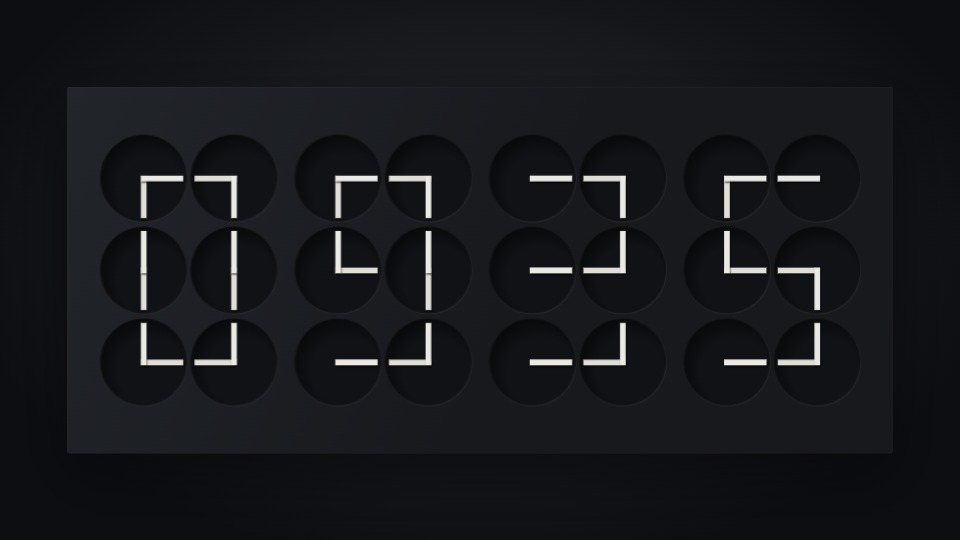

# ClockClock 24 · Kinetic Desktop 3.0.0

简体中文 · [English](README.md)

24 个钟面、48 根指针组成的离线动态时钟，显示本机 HH:mm。保留 14 款材质、12 组编舞、Quiet／Medium／Active、六档帧率、12/24 小时、尺寸和漂移设置。首次默认 60 FPS。视觉参考 Humans since 1982，代码与编舞为独立实现，非官方产品。

## 选择安装包

从 **[GitHub Releases 下载最新版本](https://github.com/SunXiaomin916/ClockClock24/releases/latest)**。在 Assets 中选择对应系统的 ZIP，每个包旁都有 `.sha256` 校验和及 `.manifest.json` 逐文件清单。



GitHub 的 **Code → Download ZIP** 只下载源码。需要直接使用桌面版，请下载 Release 附件。本地构建产物统一放在 `release/`，不提交到 Git 源码仓库。

| 文件 | 适用系统 | 使用方式 |
| --- | --- | --- |
| ClockClock24-3.0.0-Windows-x64.zip | Windows 10/11，Intel/AMD 64 位 | 完整解压，双击 ClockClock24.exe |
| ClockClock24-3.0.0-macOS-arm64.zip | macOS 13+，Apple Silicon | 完整解压，运行安装到应用程序.command |
| ClockClock24-3.0.0-macOS-x64.zip | macOS 13+，Intel | 同上 |
| ClockClock24-3.0.0-WallpaperEngine.zip | Windows + Wallpaper Engine | 解压后将 ClockClock24 复制到 projects/myprojects |
| ClockClock24-3.0.0-Source.zip | 开发／存档 | 源码、测试与构建脚本，不含依赖或桌面运行时 |

桌面包附带完整运行时，无需安装 Node.js。Wallpaper Engine 包只带 Web 运行资源。

**macOS 边界：包由 Windows 交叉打包，未在 Mac 真机运行，没有 Apple Developer ID 签名和公证。** 安装脚本用 Mac 自带的 codesign 生成本地签名；首次打开可能需要在“系统设置 → 隐私与安全性”中确认，不修改全局安全设置。对外免提示发行仍需要 Mac 签名、公证和实机验收。

## Windows / macOS 桌面版

首次启动显示设置窗口，并在主显示器桌面图标后方显示时钟。Windows 入口在任务栏通知区域，macOS 入口在顶部菜单栏。桌面层不接收鼠标，保留桌面图标操作。

- **打开设置／时钟窗口**：托盘／菜单栏菜单；Windows 也可双击托盘图标。
- **桌面壁纸**：开关桌面显示；关闭后仍可使用独立时钟窗口。
- **开机启动**：默认关闭。开启后在当前用户下次登录时启动到托盘／菜单栏，不弹设置窗口。
- **暂停动画**：暂停桌面计时和绘制，恢复后同步当前时间。
- **退出应用**：从设置或托盘／菜单栏退出；关闭窗口只隐藏设置，壁纸继续运行。

启动项只针对当前用户，无需管理员权限。Windows 使用用户启动项，macOS 使用 `~/Library/LaunchAgents/local.clockclock24.desktop.plist`。关闭开关删除本应用的登记，不改变其他软件的设置。macOS 如果被系统关闭后台运行，应另外检查系统登录项。

先把程序放在固定位置，再开启开机启动。升级、移动或删除前，关闭旧版开关并退出，在新位置重新开启。详见 [Windows 说明](docs/Windows使用说明.txt) 和 [macOS 说明](docs/macOS使用说明.txt)。

目前只覆盖主显示器，随主屏／分辨率变化重新挂载。Windows 桌面层属于兼容性适配，系统更新或其他壁纸程序可能影响它，托盘提供重试入口。不要同时运行多个程序控制同一桌面。

## Wallpaper Engine 正式内容包

1. 完整解压对应 ZIP。
2. Steam → Wallpaper Engine → 管理 → 浏览本地文件。
3. 将包内 **ClockClock24** 文件夹复制到 `projects/myprojects/`。
4. 确认 `projects/myprojects/ClockClock24/project.json` 旁边有 `index.html`、`js/`、`css/`、`preview.jpg`。
5. 打开或重新启动 Wallpaper Engine，选择本地项目并应用。

ZIP 是运输文件，需先解压。原生属性面板保留全部选项，帧率同时受宿主全局上限、屏幕和设备性能限制。开机启动在 **Wallpaper Engine 自己的设置** 中开启。系统屏保由 Wallpaper Engine 屏保组件管理，独立桌面版不提供 `.scr` 或 `.saver`。详见 [导入说明](docs/WallpaperEngine使用说明.txt)。

## 浏览器预览

双击 `index.html`，或执行 `npm start`，打开 `http://127.0.0.1:8765/?dev=1`。仅预览网页无需安装依赖。

**C** 设置、**D** 编舞、**F** 全屏、**Esc** 关闭设置。点击面板外关闭；鼠标静止 10 秒隐藏图标。开发状态文字仅在设置打开时显示。“开发预览”可模拟时间和检查四个位置的 0–9，不修改系统时间。

网页与 Wallpaper Engine 不显示桌面应用专属开关。浏览器沿用 `cc24_settings`，桌面版使用自己的用户配置文件，Wallpaper Engine 使用原生属性。

## 项目目录

```text
index.html / project.json / preview.jpg   兼容原项目的 Web 入口
js/ / css/                               共用渲染、时间、动画与界面
desktop/                                 桌面主进程、隔离桥接、启动项与图标
tests/                                   核心、浏览器和桌面应用测试
tools/                                   开发服务器、打包与校验
docs/                                    各平台说明、构建说明、历史验证
README.md / README.zh-CN.md               双语入口
使用说明.txt                             快速入口
package.json / package-lock.json         构建依赖及锁定版本
release/                                 交付 ZIP、校验文件、清单
build/ / node_modules/                    构建中间文件和开发依赖，不进入源码包
```

## 验证和限制

当前范围记录在 [发布验证](docs/发布验证.zh-CN.md)。`npm test` 无第三方依赖，UI 回归需要开发用 Playwright。构建步骤见 [构建说明](docs/构建说明.zh-CN.md)。

Windows 包未做商业代码签名，系统可能提示发布者未知。macOS 真机、真正注销／重启登录、长期运行、多显示器与不同系统版本仍需各自环境验证。材质反射为程序近似，漂移不能保证防止 OLED 烧屏，长期闲置建议熄屏。
